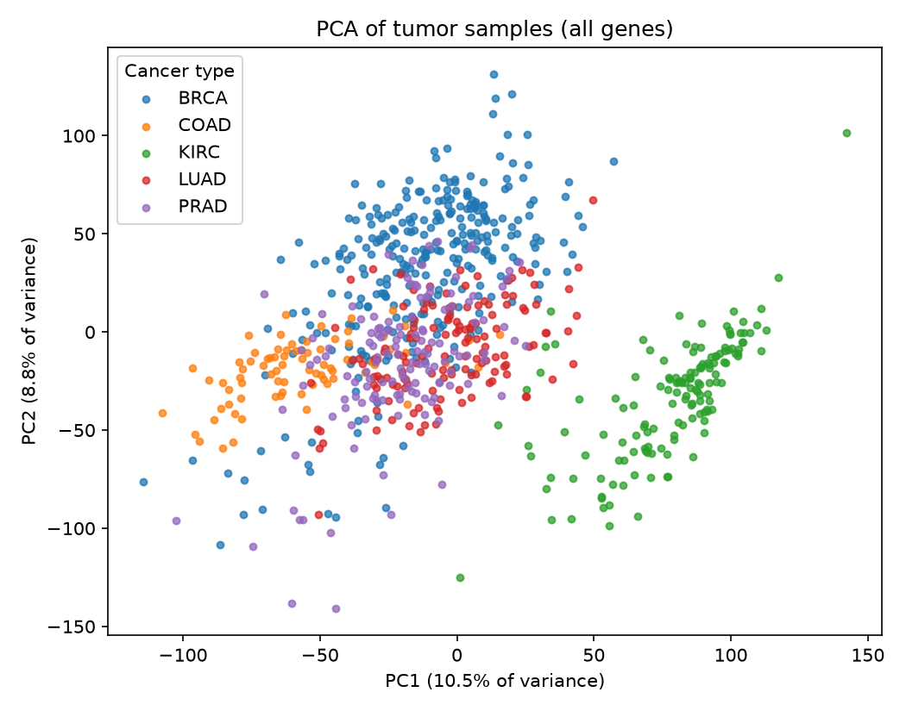
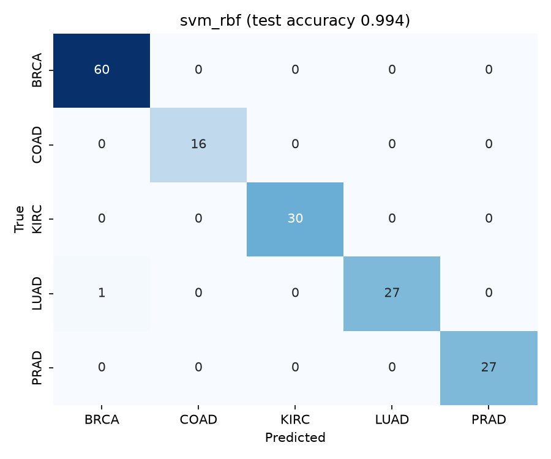

# Cancer Type Classification from Gene Expression


Predicting which of five cancers a tumor came from using only its RNA-seq gene expression profile. The data is 801 tumor samples from The Cancer Genome Atlas (TCGA), each measured across 20,531 genes.

|Code|Cancer type|Tissue|
|-|-|-|
|BRCA|Breast invasive carcinoma|Breast|
|KIRC|Kidney renal clear cell carcinoma|Kidney|
|LUAD|Lung adenocarcinoma|Lung|
|PRAD|Prostate adenocarcinoma|Prostate|
|COAD|Colon adenocarcinoma|Colon|

## Why this problem

Cancer of unknown primary makes up a few percent of cancer diagnoses: metastases are found but the original tumor can't be located. Since tumors keep much of the expression program of their tissue of origin, gene expression can point to where a tumor started, and that guides treatment. This project is a small version of that idea.

The dataset has far more features (20,531 genes) than samples (801). With that ratio it is easy to get a model that looks perfect and has learned nothing general, so most of the design here is about evaluating honestly.

## Approach

1. **Exploration** (`notebooks/01\_exploration.ipynb`): class balance, expression distributions, PCA, t-SNE and a clustered heatmap of the most variable genes.
2. **Preprocessing inside the model pipeline**: drop genes that never vary, standardize, then keep the top *k* genes by ANOVA F-test (default 500). These steps are fit on training folds only. Choosing genes on the whole dataset first would leak test information into training.
3. **Three models**: L2-regularized logistic regression, random forest (500 trees) and an RBF-kernel SVM.
4. **Evaluation**: a stratified 80/20 split holds out a test set that is used once. Model comparison uses 5-fold stratified cross-validation on the training set. Macro F1 is reported next to accuracy because the classes are unbalanced (300 BRCA samples, 78 COAD).
5. **Interpretation**: random forest feature importances rank the genes that separate the cancer types.

## Results

Results from `python -m src.train` with the 500 top genes (5-fold CV on 640 training samples, then one evaluation on 161 held-out test samples):


| Model | CV accuracy | CV macro F1 | Test accuracy | Test macro F1 | Test errors |
|-------|-------------|-------------|---------------|---------------|-------------|
| Logistic regression | 99.69% ± 0.38 | 99.74% | 99.38% | 99.47% | 1 / 161 |
| Random forest | 99.69% ± 0.38 | 99.74% | 98.76% | 98.93% | 2 / 161 |
| SVM (RBF) | 99.69% ± 0.38 | 99.74% | 99.38% | 99.47% | 1 / 161 |






All three models tied in cross-validation, so the choice of model matters little here. The few errors involve lung adenocarcinoma (LUAD): the SVM classified one lung tumor as breast cancer (BRCA). Both are adenocarcinomas, cancers of glandular tissue, which may explain why they are the hardest pair to separate.

Figures written to `results/`:

| File | What it shows |
|------|---------------|
| `pca.png` | Samples projected on the first two principal components |
| `cv_scores.png` | Macro F1 across the 5 CV folds for each model |
| `confusion_<model>.png` | Test set confusion matrix per model |
| `top_genes.png` | 20 most important genes in the random forest |

Expect accuracy close to 100%. These five cancers come from five different tissues, and tissue identity dominates tumor expression. The PCA plot already shows the groups separating before any labels are used. So the high score says more about the problem than about the models, and the confusion matrices (which classes, if any, get mixed up) and the gene rankings are the parts worth discussing.

## Limitations

* **Gene names are anonymized.** The UCI release labels genes `gene\_0` to `gene\_20530`, so the important genes can't be looked up biologically. See the next steps for a fix.
* **Tissue is an easy signal.** Telling apart cancer subtypes within one tissue (for example the PAM50 breast cancer subtypes) is a much harder test.
* **One cohort.** All samples come from TCGA. Performance on data from other hospitals or sequencing platforms is untested, and batch effects could lower it.

## Next steps

* Use the TCGA data from [UCSC Xena](https://xenabrowser.net/) with real gene symbols, then check the top genes against known tissue markers (for example, PRAD markers such as KLK3, which codes for PSA).
* Add more cancer types to make the task harder.
* Run a pathway enrichment analysis (GO or KEGG) on the top-ranked genes.
* Try the same pipeline on breast cancer subtypes.

## Project structure

```
cancer-gene-expression-classifier/
├── data/                        # downloaded data (not committed)
├── notebooks/
│   └── 01_exploration.ipynb     # exploratory analysis
├── results/                     # figures and metrics from training
├── src/
│   ├── download_data.py         # fetches the dataset from UCI
│   ├── data.py                  # loading and summary
│   ├── models.py                # sklearn pipelines
│   ├── plots.py                 # figures
│   └── train.py                 # cross-validation, testing, outputs
├── tests/
│   └── test_pipeline.py         # end-to-end test on synthetic data
├── .github/workflows/tests.yml  # runs tests on every push
└── requirements.txt
```

## How to run

```bash
git clone https://github.com/sanahameed493-cpu/cancer-gene-expression-classifier.git
cd cancer-gene-expression-classifier
python -m venv .venv
source .venv/bin/activate        # Windows: .venv\Scripts\activate
pip install -r requirements.txt

python -m src.download_data      # about 70 MB
python -m src.train              # takes a few minutes
python -m src.train --k-genes 100   # try a different number of genes

pytest                           # tests use synthetic data, no download needed
```

If the download fails, get the dataset by hand from the [UCI page](https://archive.ics.uci.edu/dataset/401/gene+expression+cancer+rna+seq) and put `data.csv` and `labels.csv` in `data/`.

## Data source

Samuele Fiorini. *Gene expression cancer RNA-Seq*. UCI Machine Learning Repository, 2016. https://archive.ics.uci.edu/dataset/401

The data comes from the TCGA Pan-Cancer project: The Cancer Genome Atlas Research Network et al., "The Cancer Genome Atlas Pan-Cancer analysis project," *Nature Genetics* 45, 1113–1120 (2013).

## License

MIT


